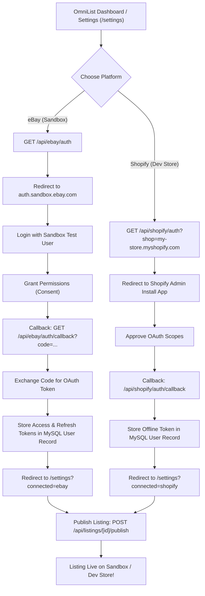

# Complete Guide: Creating & Operating Marketplace Seller Accounts from Pakistan
### Legal Framework, Banking, Taxes, and OmniList Multi-Platform Auth Testing

---

## 📑 Table of Contents
1. [Executive Summary](#executive-summary)
2. [Testing Marketplace Auth Without a Live Seller Account](#1-testing-marketplace-auth-without-a-live-seller-account)
   - [2.1 eBay Sandbox (100% Free, Zero Bank Required)](#21-ebay-sandbox-100-free-zero-bank-required)
   - [2.2 Shopify Partner Development Stores (Unlimited Free Stores)](#22-shopify-partner-development-stores-unlimited-free-stores)
   - [2.3 Amazon SP-API Sandbox](#23-amazon-sp-api-sandbox)
3. [Creating a Live eBay Seller Account from Pakistan](#2-creating-a-live-ebay-seller-account-from-pakistan)
   - [3.1 Model A: Pakistani Individual / Sole Proprietorship (Direct via Payoneer)](#31-model-a-pakistani-individual--sole-proprietorship-direct-via-payoneer)
   - [3.2 Model B: US LLC / UK LTD Formation (Recommended for High Scale & Lower Suspension Risk)](#32-model-b-us-llc--uk-ltd-formation-recommended-for-high-scale--lower-suspension-risk)
   - [3.3 Step-by-Step eBay + Payoneer Verification Flow](#33-step-by-step-ebay--payoneer-verification-flow)
   - [3.4 Avoiding the Dreaded eBay "MC011" Account Suspension](#34-avoiding-the-dreaded-ebay-mc011-account-suspension)
4. [Legal & Regulatory Framework in Pakistan](#3-legal--regulatory-framework-in-pakistan)
   - [4.1 FBR (Federal Board of Revenue) Registration & Tax Filing](#41-fbr-federal-board-of-revenue-registration--tax-filing)
   - [4.2 State Bank of Pakistan (SBP) Foreign Exchange Regulations](#42-state-bank-of-pakistan-sbp-foreign-exchange-regulations)
   - [4.3 B2C E-Commerce Courier Export Framework (SBP FE Circular No. 04 of 2020)](#43-b2c-e-commerce-courier-export-framework-sbp-fe-circular-no-04-of-2020)
   - [4.4 PSEB (Pakistan Software Export Board) Registration (For OmniList SaaS)](#44-pseb-pakistan-software-export-board-registration-for-omnilist-saas)
5. [Banking, Payouts & Currency Inward Remittance](#4-banking-payouts--currency-inward-remittance)
   - [5.1 Payoneer Setup & Verification from Pakistan](#51-payoneer-setup--verification-from-pakistan)
   - [5.2 Local Pakistani Bank Accounts (Meezan, HBL, Faysal) & e-PRC](#52-local-pakistani-bank-accounts-meezan-hbl-faysal--e-prc)
   - [5.3 Exporter Special Foreign Currency Retention Accounts (ESRA)](#53-exporter-special-foreign-currency-retention-accounts-esra)
6. [Testing the OmniList Auth Flow Step-by-Step](#5-testing-the-omnilist-auth-flow-step-by-step)
7. [Alignment with Meeting Notes (Michal / Co-founder Discussions)](#6-alignment-with-meeting-notes-michal--co-founder-discussions)

---

## Executive Summary

You **do not** need an approved live eBay seller account or a funded bank account to test the eBay integration in OmniList today. eBay provides a dedicated **Sandbox Developer Environment** that allows you to generate simulated seller test accounts instantly.

When you are ready to launch commercially from Pakistan, eBay accepts Pakistani sellers via **eBay Managed Payments connected to Payoneer**, or alternatively through a **US LLC / UK LTD** for international corporate standing.

This guide provides the exact technical procedures to test authentication in OmniList and the end-to-end legal compliance checklist under Pakistani law (FBR, SBP, SECP, WeBOC).

---

## 1. Testing Marketplace Auth Without a Live Seller Account

### 2.1 eBay Sandbox (100% Free, Zero Bank Required)

The eBay Developer Program provides a sandbox environment with mock buyers, sellers, and listings.

#### Step 1: Create an eBay Developer Account
1. Visit [developer.ebay.com](https://developer.ebay.com/) and register for a free Developer Account.
2. Under **Application Keys**, you will see two sets of keys:
   - **Sandbox Keys** (App ID, Dev ID, Cert ID)
   - **Production Keys** (App ID, Dev ID, Cert ID)

#### Step 2: Create a Sandbox Seller Test User
1. In the eBay Developer portal, click on your username at the top right and select **Sandbox Accounts** (or go to **User Tokens** → **Sandbox Users**).
2. Click **Create Sandbox User**.
3. Select **Account Type: Business/Seller**.
4. eBay will generate a mock username (e.g. `TESTUSER_omnilist_seller`) and let you assign a password.
5. This mock user has pre-configured simulated feedback, selling limits, and payment processing enabled in the sandbox.

#### Step 3: Configure OmniList for Sandbox Testing
1. In OmniList `.env`, set:
   ```env
   EBAY_CLIENT_ID="<your-sandbox-app-id>"
   EBAY_DEV_ID="<your-sandbox-dev-id>"
   EBAY_CLIENT_SECRET="<your-sandbox-cert-id>"
   EBAY_REDIRECT_URI="https://mediumslateblue-dinosaur-388048.hostingersite.com/api/ebay/auth/callback"
   EBAY_RUNAME="<your-sandbox-ru-name>"
   EBAY_SANDBOX=true
   ```
2. In OmniList, navigate to `/settings` or `/api/ebay/auth`.
3. The browser will redirect you to:
   `https://auth.sandbox.ebay.com/oauth2/authorize?...`
4. Log in with your **Sandbox Seller Test User** credentials.
5. Click **Agree & Continue** to grant listing and inventory permissions.
6. eBay redirects back to `/api/ebay/auth/callback`, which exchanges the authorization code for an OAuth Access Token and Refresh Token, binding them to your authenticated OmniList user record in MySQL.
7. You can now publish listings to `https://sandbox.ebay.com` without spending any real money or linking any bank accounts.

---

### 2.2 Shopify Partner Development Stores (Unlimited Free Stores)

To test Shopify store integration without paying \$39/month for a store:

1. Sign up for a free [Shopify Partner Account](https://partners.shopify.com/).
2. In the Partner Dashboard, click **Stores** → **Add store** → **Create development store**.
3. Choose **Create a store for client review or testing**.
4. Development stores are **free forever**, provide access to all Shopify Plus features, and support mock checkout testing.
5. Go to **Apps** → **Develop apps** (or create a Custom App via Partner Dashboard).
6. Enable Admin API permissions:
   - `write_products`, `read_products`
   - `write_inventory`, `read_inventory`
7. Set the App Redirect URL to:
   `https://mediumslateblue-dinosaur-388048.hostingersite.com/api/shopify/auth/callback`
8. In OmniList, connect the store using your `.myshopify.com` test domain. You can test product drafting, image syncing, and live publishing seamlessly.

---

### 2.3 Amazon SP-API Sandbox

Amazon provides a Selling Partner API (SP-API) Sandbox:
- Endpoint: `https://sandbox.sellingpartnerapi-na.amazon.com`
- Allows developers to test order retrieval, inventory feeds, and catalog queries using static mock data without an active professional selling subscription.

---

## 2. Creating a Live eBay Seller Account from Pakistan

When launching live commercial operations, you have two business structures:

### 3.1 Model A: Pakistani Individual / Sole Proprietorship (Direct via Payoneer)

eBay officially supports Pakistan-based sellers under its **Cross-Border Trade (CBT)** program. eBay does **not** use PayPal for Pakistan; it uses **eBay Managed Payments with Payoneer**.

#### Required Documents for Model A:
| Document | Requirements |
| :--- | :--- |
| **CNIC / Passport** | Smart NIC (with English text) or valid Pakistani Passport. Old Urdu-only NICs are rejected. |
| **Proof of Address** | Bank account statement or utility bill (K-Electric, SNGPL, PTCL) issued within the last 90 days. The name and address must match the CNIC and eBay account character-for-character. |
| **Bank Account** | A PKR bank account in any commercial bank (Meezan, HBL, Bank Alfalah, etc.) with an active IBAN. |
| **Payoneer Account** | A verified Payoneer account in the same personal or sole proprietor name. |
| **FBR NTN** | National Tax Number registered on the FBR Iris portal as a salaried or sole-proprietor business individual. |

---

### 3.2 Model B: US LLC / UK LTD Formation (Recommended for High Scale)

For enterprise-grade reliability, higher starting selling limits, and lower algorithmic suspension risks, the industry standard for Pakistani e-commerce exporters is to register an overseas legal entity.

#### How It Works:
1. **Form a US LLC** (Wyoming or Delaware are favored for non-resident e-commerce due to low franchise taxes and strong privacy laws). Services like Firstbase, Doola, or Northwest Registered Agent handle this remotely (\$300–\$500).
2. **Obtain a US EIN (Employer Identification Number)** from the IRS.
3. **Open a US Business Bank Account** remotely through **Mercury Bank** or **Relay Financial** (requires valid passport and approved LLC documents).
4. **Register a US eBay Business Account**:
   - Register on [ebay.com](https://www.ebay.com) as a US Business.
   - Enter your US LLC EIN and Mercury Bank routing/account number.
   - Payouts are deposited directly in USD into your US bank account, which can then be transferred to Pakistan via Wise Business or SWIFT wire at favorable exchange rates.

---

### 3.3 Step-by-Step eBay + Payoneer Verification Flow

For Model A (Pakistani Seller Account):
1. **Sign Up on eBay.com**:
   - Go to [ebay.com](https://www.ebay.com) and click **Register**.
   - Select **Personal Account** (or **Business Account** if you have a registered sole proprietorship/NTN).
   - Enter your real Pakistani residential address, phone number (`+92`), and email.
2. **Create Your First Draft Listing**:
   - Click **Sell** at the top right.
   - Enter a product title and click **List It**.
   - eBay will intercept you with: *"To complete your listing, set up your seller account."*
3. **Link Payoneer to eBay**:
   - eBay will redirect you to Payoneer.
   - **Crucial Rule:** If you already have a Payoneer account, select *"Yes, sign in to my existing Payoneer account"*. The name on your eBay account **must be an exact match** to the name on your Payoneer account.
   - If creating a new Payoneer account, complete the form using your Smart CNIC and local Pakistani bank IBAN.
4. **Identity & Document Verification**:
   - Payoneer will request a color photo of your Smart CNIC or Passport.
   - Payoneer will ask for a bank statement or utility bill verifying your residential address.
   - Verification typically takes 24 to 72 hours.
5. **Add a Backup Credit/Debit Card**:
   - eBay requires an active debit or credit card (Visa or Mastercard enabled for international online transactions) for seller fee backup billing.
   - Pakistani cards from **Nayapay**, **Sadapay**, **Meezan Bank**, or **Bank Alfalah** work reliably. Make sure international e-commerce sessions are enabled in your banking app.

---

### 3.4 Avoiding the Dreaded eBay "MC011" Account Suspension

New eBay accounts from non-US/UK regions are subject to automated risk profiling. To prevent temporary or permanent suspension (`MC011` / `MC999`):
1. **Never use a VPN or Datacenter Proxy when logging into eBay or Payoneer.** Log in directly from your genuine Pakistani home/office broadband IP (PTCL, Nayatel, StormFiber). Logging in via a US VPN with a Pakistani account triggers immediate fraud flags.
2. **Start with modest listing volumes.** Do not list 50 high-ticket brand items (Apple, Sony, Nike) on Day 1. Start with 1 to 3 low-risk, unbranded items or domestic craft items.
3. **Use authentic UPC/EAN barcodes.** Avoid fake or duplicate barcodes. OmniList provides authentic barcode lookup tools to prevent trademark disputes.
4. **Ship with verifiable end-to-end tracking.** Use courier services integrated with eBay's tracking system:
   - DHL Express
   - FedEx Cross-Border
   - UPS
   - Pakistan Post EMS (Express Mail Service) with valid international tracking numbers.

---

## 3. Legal & Regulatory Framework in Pakistan

### 4.1 FBR (Federal Board of Revenue) Registration & Tax Filing

1. **Obtain an NTN (National Tax Number)**:
   - Register on the FBR Iris portal (`https://iris.fbr.gov.pk/`).
   - For an individual/sole proprietorship, your NTN is your 13-digit CNIC.
   - Add your business name (e.g., "OmniList E-Commerce") under Business Details.
2. **Tax Filing & Income Classification**:
   - Inward remittances from international e-commerce and SaaS subscriptions must be properly classified in your annual income tax return.
   - Export of IT services and SaaS products (OmniList platform revenue) qualifies for reduced or 1% final tax regime under **Section 154A** of the Income Tax Ordinance, provided foreign remittances are routed through official banking channels.
   - For physical goods e-commerce exports, foreign exchange receipts are recognized as export proceeds.

---

### 4.2 State Bank of Pakistan (SBP) Foreign Exchange Regulations

All foreign funds received in Pakistan are governed by the **Foreign Exchange Regulation Act, 1947 (FERA)** and the **SBP Foreign Exchange Manual**.

Key provisions for online sellers:
- All inward funds must be received via Authorized Dealers (commercial banks licensed by the SBP).
- Payoneer routes withdrawals to Pakistani banks through local clearing partnerships (such as Standard Chartered or Citi clearing). The bank credits the funds in PKR and reports the transaction to the SBP under the appropriate Purpose Code.

---

### 4.3 B2C E-Commerce Courier Export Framework (SBP FE Circular No. 04 of 2020)

Previously, every export consignment from Pakistan required an advance regulatory **Form-E** filed through WeBOC (Web-Based One Customs), which was prohibitively complex for small single-item e-commerce parcels.

In 2020, the State Bank of Pakistan introduced **FE Circular No. 04 of 2020: Regulatory Framework for B2C E-Commerce Exports via Couriers**:
- **Exemption from Form-E:** B2C e-commerce exports up to **USD \$5,000 per consignment** can be dispatched through certified couriers (DHL, FedEx, Pakistan Post) without filing an advance manual Form-E.
- **Courier-Assisted Clearance:** The courier acts as the authorized agent, lodging the export declaration in WeBOC under the simplified B2C module.
- **Realization of Proceeds:** The seller must ensure that the export proceeds are received in Pakistan through banking channels (Payoneer or direct bank transfer) within **180 days** from the export date.

---

### 4.4 PSEB (Pakistan Software Export Board) Registration (For OmniList SaaS)

Because OmniList is a software product / SaaS platform:
1. Register OmniList / your software enterprise with **PSEB** (`https://pseb.org.pk/`).
2. Benefits of PSEB registration:
   - Eligibility for 100% foreign exchange retention or Special Exporter Retention Accounts (up to 50% retained in USD).
   - Legitimate standing with local banks for processing high-volume foreign SaaS subscription payments without arbitrary compliance holds.
   - Exemption from provincial sales tax on IT exports (SRB, PRA, KPRA).

---

## 4. Banking, Payouts & Currency Inward Remittance

### 5.1 Payoneer Setup & Verification from Pakistan

1. Register on [payoneer.com](https://www.payoneer.com/) choosing **Individual** or **Company**.
2. Link your local Pakistani bank account using your **IBAN** (24 characters, starting with `PK...`).
3. Complete the **Verification Center** tasks:
   - Government-issued photo ID (Smart CNIC or Passport).
   - Proof of Address (Bank statement matching your name and residential address).
   - Business questionnaire: select "E-commerce seller / Marketplace seller" and provide your eBay store link (or OmniList URL).

---

### 5.2 Local Pakistani Bank Accounts & e-PRC

When you withdraw USD from Payoneer to a Pakistani bank (Meezan, HBL, Bank Alfalah, Faysal):
1. **Conversion:** The funds are converted to PKR at the interbank/commercial exchange rate.
2. **Obtain an e-PRC (Electronic Proceeds Realization Certificate):**
   - An e-PRC is the official certificate issued by the Pakistani bank proving that the money came from an international source via legal banking channels.
   - You can download e-PRCs directly from the online banking portal (e.g. Meezan Bank Internet Banking → e-PRC Generator).
   - Keep all e-PRCs filed; they are required by the FBR to substantiate your foreign income and claim reduced tax rates.

---

### 5.3 Exporter Special Foreign Currency Retention Accounts (ESRA)

Under recent SBP guidelines for IT exporters and digital services:
- Exporters can open an **ESRA (Exporter Special Foreign Currency Account)** with Pakistani commercial banks.
- You can legally retain **up to 35% to 50%** of your incoming foreign currency directly in **USD** in Pakistan (instead of mandatory 100% conversion to PKR).
- These retained USD can be used to pay for international SaaS tools, server hosting (Hostinger, AWS, Vercel), APIs (Gemini, OpenAI), and digital marketing without foreign exchange control restrictions.

---

## 5. Testing the OmniList Auth Flow Step-by-Step

Here is how to test the complete multi-platform integration in OmniList:



### Quick Verification Checklist in OmniList:
- [x] **Database Connectivity:** Fixed sanitized URL with `#` and `!` URL-encoded (`%23` and `%21`). Verified live user registration on Hostinger.
- [ ] **Connect eBay Sandbox:** Click "Connect eBay" on `/settings`, log in with your eBay Sandbox developer user, and verify status displays **Connected**.
- [ ] **Connect Shopify Store:** Enter your `.myshopify.com` test store domain, approve permissions, and verify status displays **Connected**.
- [ ] **Draft a Product:** Go to `/products`, enter any barcode (UPC), click **Generate Draft**.
- [ ] **Approve & Queue:** In the draft panel, click **Approve & Queue**. Verify the listing moves to `/listings` in `QUEUED` status and updates the queue counter on the Dashboard.
- [ ] **Publish Live:** On `/listings`, click **Publish Now**. The server executes `publishListingToEbay()` or Shopify Admin API, uploads images, sets inventory, and transitions the listing to `LIVE`.

---

## 6. Alignment with Meeting Notes (Michal / Co-founder Discussions)

During the Nov 5 meeting with Michal, several strategic points were agreed upon:
1. **Dynamic Pricing & Dimension/Weight Calculation:**
   - In cross-border e-commerce from Pakistan, dimensional weight (`Length x Width x Height / 5000`) determines courier shipping costs via DHL/FedEx.
   - OmniList’s pricing engine must factor in dimensional shipping brackets + marketplace commission (eBay takes ~13.25% + \$0.30; Payoneer takes ~1-2% withdrawal fee) to compute net profit margins automatically.
2. **Centralized Multi-Channel Sync:**
   - Having unified catalog management (eBay, Shopify, Amazon) prevents double-selling out of inventory when a product sells on one marketplace.
3. **Sound Business Proposition for Clients:**
   - By operating cleanly within Pakistani banking guidelines (e-PRC, SBP FE Circular 04, Payoneer) or via a US LLC, OmniList provides clients and OEMs with a turnkey, fully compliant cross-border selling pipeline.

